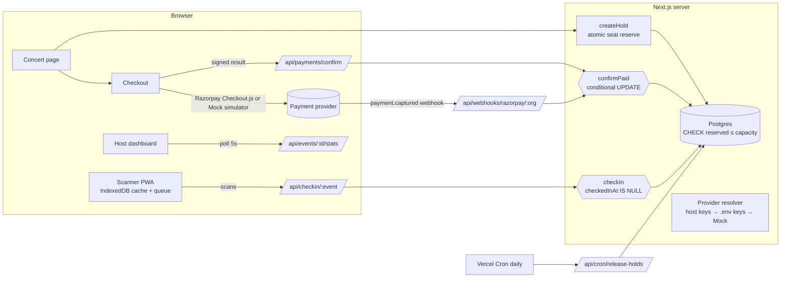
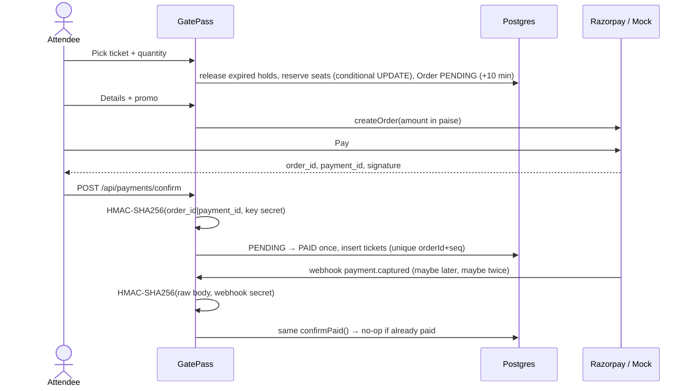

# GatePass

Ticketing and QR check-in for college concerts and gigs: sell limited seats without overselling, take payments through your own Razorpay account, and scan people in with any phone.

**Live demo:** TODO — add the Vercel link after deploying.

## Who is this for and what problem does it solve?

College music clubs and fest teams in India run concerts like this today:

- Registrations go through Google Forms, and someone checks UPI payment screenshots by hand.
- Limited seats get oversold because two people pay for the last seat at the same time.
- At the gate, volunteers tick names off a printed list, which causes long queues and lets people share screenshots of the same pass.

GatePass replaces that whole chain. The host builds a concert page with ticket types. Buyers get a seat hold, pay, and receive a signed QR ticket. Volunteers scan with their phone camera and see green, amber or red in under a second, even with a weak connection.

## Screenshots

TODO: add screenshots to `docs/` (concert page, checkout, ticket, scanner result, host dashboard, payments settings) and link them here.

## Features

**For attendees**

- Concert page that looks like a gig poster.
  - Ticket types are shown as physical tickets.
  - Shows a live "seats left" count, a price ladder ("₹499 now · ₹699 after 80 more sold"), flash-drop countdowns, and a waitlist when a tier is sold out.
- 10-minute seat hold with a visible countdown. Expired holds release automatically.
- Checkout with promo codes. Group deals and happy-hour prices are applied automatically.
- Ticket page:
  - A signed QR code.
  - Add-to-calendar for Google and .ics.
  - A personal referral link.
  - The ticket tilts and can be flung, with real spring physics.
- "Find my tickets" using email and phone together.

**For hosts (admins)**

- Concert builder with a live preview: details, poster upload, lineup and set times, FAQ, custom checkout questions, accent colour, and ticket-stock style.
- Ticket types: price, quantity, sale window, per-order limit, "admits N" (Group of 4 = one QR for four people), flash drops, hidden presale codes, and price ladders.
- Promotions hub:
  - Discount codes: % or ₹ off, usage caps, per-person limits, college-email-only.
  - Happy hour.
  - Group deals.
  - Giveaways with a verifiable random draw.
  - A fan-ambassador referral leaderboard.
  - Waitlist auto-offers.
- Live dashboard: people sold, test revenue, check-ins vs sold, sold per ticket type, entries per 15 minutes, and the latest scans.
- Attendee search, guest-list (comp) tickets, CSV export, and **one-click refunds**:
  - Through the Razorpay refund API, or simulated in Mock mode.
  - The order row is locked during the refund, so it can never be refunded twice.
  - Refunded QR codes are rejected at the gate, and the seats go back on sale (waitlist first).
- Optional **ticket and invite emails** through Resend.
- Team: invite volunteers or admins with a one-time link, change roles, remove people (they are signed out immediately).
- **Payments settings:** paste your Razorpay Key ID and Secret, press _Test connection_, and new checkouts go to your Razorpay account. Three modes:
  - **Mock:** default, no keys needed.
  - **Razorpay Test:** unlocks once your test keys are verified.
  - **Live:** locked behind a readiness checklist (verified live keys, webhook secret, a received webhook, HTTPS, refund policies).

**For volunteers**

- Phone camera scanner (PWA) with full-screen results:
  - **VALID** (green).
  - **ALREADY IN · 6:42 PM by Ravi** (amber).
  - **NOT VALID** (red).
- Manual search by name, the last 4 digits of a phone number, or the ticket serial.
- Works offline:
  - The guest list is cached in IndexedDB.
  - Scans queue up and sync when the connection returns.
  - The server's first-scan-wins rule settles conflicts.
- Volunteers can only reach the scanner. Every admin page and API rejects them.

## Tech stack

Next.js 16 (App Router, Cache Components) · TypeScript (strict) · Tailwind CSS 4 + custom design tokens · PostgreSQL on Neon · Prisma 7 (driver adapter) · zod · bcryptjs · Razorpay (REST + Checkout.js) · `qrcode` · `qr-scanner` · `idb` · Vitest.

## Production readiness

- **Security headers:** CSP (Razorpay domains only), `X-Frame-Options: DENY`, HSTS, `nosniff`, a strict referrer policy, and a camera-only Permissions-Policy.
- **Rate limits in Postgres** (one atomic upsert, keys hashed), so they hold across serverless instances. They cover login, sign-up, holds, payment confirmation, lookups, waitlist, giveaways and key changes.
- **Auth:**
  - bcrypt passwords.
  - Database sessions stored as SHA-256 of the token.
  - Login timing equalised to prevent account enumeration.
  - Removed members are signed out immediately.
- **Secrets:** hosts' Razorpay secrets are encrypted with AES-256-GCM and never sent back to the browser.
- **Validation:** all input goes through zod on the server; posters are checked by magic bytes; the CSV export guards against formula injection.
- **Startup:** missing environment variables fail fast with a clear message (`instrumentation.ts`).
- **Monitoring:** `GET /api/health` reports database up/down for uptime monitors.
- **CI** (GitHub Actions): Prettier check, ESLint, `tsc`, migrations, all tests against a real Postgres service, and a production build.

## Architecture



**Payment flow**



## Design decisions

1. **Seat inventory as a counter with a database CHECK, not a row-count query.**
   - How it works: holding seats is a single `UPDATE … SET reserved = reserved + n WHERE reserved + n <= capacity`, and `CHECK (reserved <= capacity)` makes overselling impossible even if application code is wrong.
   - Alternatives considered: `SELECT … FOR UPDATE` plus a count, or Redis locks.
   - Trade-off: the counter has to be kept in sync on every release path. All of those paths go through one SQL function (`expireOrders`), which the concurrency tests cover with 40 buyers racing for 10 seats.
2. **Lazy hold release on read, plus a daily cron.**
   - How it works: any time inventory is read (concert page, a new hold, a waitlist link), expired holds are released in the same transaction. Vercel's free tier only allows daily cron jobs, so the daily job just catches concerts nobody visited.
   - Alternative considered: a cron job every minute.
   - Trade-off: a seat can look taken for a few seconds past its expiry until the next read.
3. **One `confirmPaid()` for both payment paths.**
   - How it works: the checkout callback and the webhook both call it. It flips `PENDING → PAID` with a conditional UPDATE, and tickets have `unique(orderId, seq)`, so retries, double delivery and both paths racing produce exactly one set of tickets.
   - Late payments (arriving after the hold expired) re-reserve seats if any are left, otherwise the order is flagged `NEEDS_REFUND`. It is never oversold.
   - Alternative considered: a distributed lock. Trade-off: none worth mentioning; the database already guarantees this.
4. **QR = 128-bit random ticket ID + truncated HMAC.**
   - The ID alone is unguessable, and the HMAC proves GatePass issued it.
   - Offline scanners can't check the HMAC (that would mean putting the secret on volunteer phones). Instead they match the ID against the cached guest list, which is just as hard to forge, and the server re-checks on sync.
   - Trade-off: a stolen QR screenshot still works once. First scan wins, and the second scan shows who was let in and when.
5. **Payment provider interface with per-host keys.**
   - Mock and Razorpay implement the same interface and the same signature formulas.
   - Hosts' secrets are encrypted with AES-256-GCM before storage.
   - Each order records which provider created it, so switching modes mid-checkout can't break a pending payment.
   - Alternative considered: keys in env only. Trade-off: losing `APP_ENCRYPTION_KEY` means every host has to re-enter their keys.

## How to run locally

You need Node 20+ and a free [Neon](https://neon.tech) Postgres database.

```bash
npm install
cp .env.example .env        # fill in DATABASE_URL, DIRECT_URL, TEST_DATABASE_URL and generate the secrets
npm run db:migrate          # apply migrations
npm run db:seed             # optional: clearly labelled DEMO concert + demo logins (printed once)
npm run dev                 # http://localhost:3000
```

Run the tests (they use the isolated schema in `TEST_DATABASE_URL`):

```bash
npm test
npm run lint && npm run typecheck && npm run build
```

With no Razorpay keys, every checkout uses the **Mock** simulator. It can:

- Succeed.
- Fail.
- "Pay and close the tab". This skips the checkout callback, so the ticket is issued only by a signed webhook that arrives about 4 seconds later (sent twice to show idempotency).

## Deploy

1. Push the repo to GitHub and import it in **Vercel**. Framework: Next.js. The build command is `npm run build`, which runs `prisma generate` first.
2. Add every variable from `.env.example` in Vercel → Settings → Environment Variables:
   - `APP_URL` = your `https://` Vercel URL.
   - Generate fresh secrets for production.
3. Run the migrations against Neon once from your machine: `DIRECT_URL=... npx prisma migrate deploy`.
4. `vercel.json` already schedules `/api/cron/release-holds` daily. Vercel sends `Authorization: Bearer $CRON_SECRET` automatically when `CRON_SECRET` is set.
5. Open `/signup`, create your host account, and add a concert.

### Connecting Razorpay (per host, no redeploy)

1. Razorpay Dashboard (Test mode) → Account & Settings → API Keys → generate keys.
2. In GatePass → **Payments** → Razorpay test keys → paste the Key ID and Key Secret → **Test connection & save**. New checkouts now go to your Razorpay test account.
3. Add the webhook: Razorpay → Account & Settings → **Webhooks** → Add new webhook:
   - URL: the one shown on the Payments page (`https://<your-app>/api/webhooks/razorpay/<orgId>`).
   - Event: `payment.captured`.
   - Secret: any strong string. Paste the same secret into GatePass.
4. Make one test payment. The "signed webhook reached GatePass" item on the Live checklist turns green.
5. **Live:** after Razorpay activates your account (KYC), paste the `rzp_live_` keys. Live unlocks once every checklist item is done.

App-wide keys work too: set `RAZORPAY_KEY_ID`, `RAZORPAY_KEY_SECRET` and `RAZORPAY_WEBHOOK_SECRET`, and use `https://<your-app>/api/webhooks/razorpay` as the webhook URL. Hosts who connect their own account take priority over these.

### Testing webhooks locally with a tunnel

```bash
npm run dev
cloudflared tunnel --url http://localhost:3000     # or: ngrok http 3000
```

Use the printed `https://…trycloudflare.com/api/webhooks/razorpay/<orgId>` as the webhook URL in Razorpay (Test mode), with the same secret you saved in GatePass. Pay with a test card, then close the tab before Checkout returns. The order still turns PAID through the webhook.

## Limitations and what breaks at scale

- **Hot ticket types.** Every hold on one ticket type updates the same row. Postgres handles hundreds of holds per second, but a 50,000-person flash drop would queue up on that row lock. The fix would be sharding inventory into buckets or using a queue in front of it.
- **The dashboard polls every 5 seconds** instead of using push. That's fine for a few hosts, wasteful for hundreds; server-sent events would be the next step.
- **Email is optional (Resend).** Without it, tickets are delivered as on-screen links plus lookup by email and phone. Drop alerts and waitlist offers are never emailed; fans see them only when they revisit the page.
- **Posters are stored in Postgres** (≤1.5 MB, magic bytes checked). Simple, but object storage (Vercel Blob or R2) is better at scale.
- **Refunds are all-or-nothing per order.** You can't partially refund one ticket of a group order, and an order where anyone has already entered can't be refunded from GatePass.
- **Offline scanning trusts the cached list.** Two phones offline at the same moment could both admit the same ticket. The server keeps the first scan and reports the conflict on sync.
- **No password reset or 2FA for hosts yet.** Sessions are database-backed and revocable, but account recovery needs an admin to re-invite.
- **The CSP allows `'unsafe-inline'` scripts** because Next's inline bootstrap and the theme script need it without nonces. Nonce-based CSP would be stricter.

## Usage tracking

`UsageEvent` stores action counts only (no personal data): organisations created, concerts published, holds, paid orders, check-ins, promos, giveaway draws, payment connections and CSV exports. Example query: `select type, count(*) from "UsageEvent" group by type;`.

## What I learned

- Correctness under concurrency is easiest when the database enforces it. Conditional `UPDATE`s plus `CHECK` and `UNIQUE` constraints beat application-level locks, and they're testable by actually racing requests.
- Payment confirmation needs two independent paths (client callback and webhook) that converge on one idempotent function. Otherwise "the user closed the tab" becomes a support ticket.
- Next.js 16 Cache Components force you to decide, for every component, what is static, what is cached and what is per-request. It's strict at first, but it made loading states (skeletons) the default.
- Building a mock provider with the same signature scheme as the real one meant the whole app and all tests run without any external account.

## What I'd improve next

- WhatsApp delivery for tickets, drop alerts and waitlist offers (email already works through Resend).
- Ticket transfer to a friend, and partial refunds for group orders.
- Real-time dashboard updates over server-sent events, and host password reset with 2FA.

---

**GitHub About line:** Concert ticketing and QR gate check-in for college gigs: oversell-proof seat holds, Razorpay payments, offline phone scanner.

**Suggested topics:** `nextjs` `razorpay` `ticketing` `qr-code` `postgresql`
